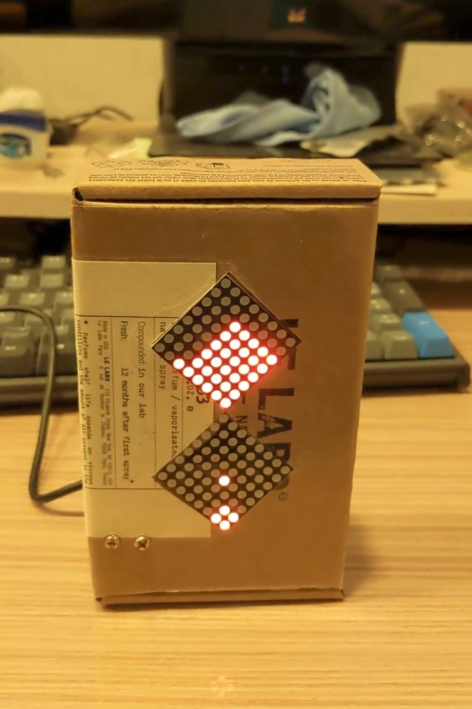

# Hourglass

用兩片 8x8 LED 矩陣（MAX7219）和加速度計（ADXL335）做的電子沙漏。傾斜裝置時，沙粒會往重力方向流動，並從兩片矩陣相接的角落慢慢漏到另一片。

## 材料

- Arduino Nano（或 Pro Mini 等有 A6、A7 腳位的板子；Uno 沒有 A6/A7）
- MAX7219 8x8 LED 矩陣模組 × 2（串接）
- ADXL335 三軸加速度計模組

## 接線

| 元件 | 腳位 | Arduino |
|---|---|---|
| MAX7219 | DIN | D11 (MOSI) |
| MAX7219 | CLK | D13 (SCK) |
| MAX7219 | CS / LOAD | D10 (SS) |
| ADXL335 | X | A5 |
| ADXL335 | Y | A6 |
| ADXL335 | Z | A7 |

兩片 MAX7219 串接：第一片的 DOUT 接第二片的 DIN。程式裡的「上片」是串接鏈上離 Arduino 較遠的那一片。兩片矩陣以角落相接：上片的 (0,0) 接下片的 (7,7)。

## 設定

可調整的參數都在 `Hourglass.ino` 的開頭：

| 參數 | 說明 |
|---|---|
| `FRAME_DELAY` | 每一幀的間隔 (ms) |
| `DROP_DELAY_TICK` | 沙粒穿過瓶頸前要等待的幀數，越大漏得越慢 |
| `ACCEL_X_MAX` / `ACCEL_X_MIN` | X 軸傾斜到兩端時的讀值 |
| `ACCEL_Y_MAX` / `ACCEL_Y_MIN` | Y 軸傾斜到兩端時的讀值 |
| `ACCEL_Z_MAX` / `ACCEL_Z_MIN` | Z 軸讀值在這個範圍內（大致直立）才更新方向 |
| `DEBUG_SERIAL` | 設為 1 時，每幀從 Serial 印出加速度計讀值和判斷出的方向 |

## 校正加速度計

每顆 ADXL335 的讀值都不太一樣，換感測器或供電電壓後要重新校正：

1. 保持 `DEBUG_SERIAL` 為 1，上傳程式，用序列埠監控視窗（115200 baud）觀察讀值。
2. 把裝置分別往左右傾斜到底，記下 X 的最大與最小值，填入 `ACCEL_X_MAX`、`ACCEL_X_MIN`。
3. 同樣往前後傾斜，記下 Y 的最大與最小值，填入 `ACCEL_Y_MAX`、`ACCEL_Y_MIN`。
4. 在裝置直立轉動時觀察 Z 的變化範圍，設定 `ACCEL_Z_MAX`、`ACCEL_Z_MIN`。
